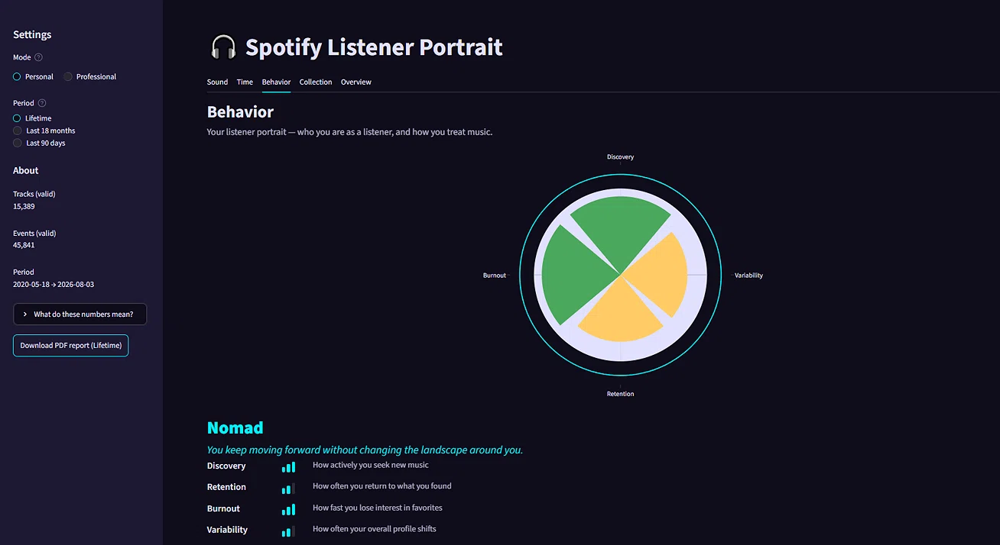

🇬🇧 English | [🇷🇺 Русский](./README_ru.md)

# Spotify Listener Portrait

**When an algorithm and a human disagree — who is right?**

The standard changepoint detector (PELT), run on 6 years of personal listening history (N=1), returned 7 dates. An independent check using three layers of points (sound, behavior, artist lineup) confirmed five of them to the nearest month, one (2022-05) — only through a different mechanism (artist shift), one (2022-10) — was not confirmed anywhere, and it added three points the naive method did not see at all.

There are two equally useless ways to react to such a discrepancy: trust the algorithm or distrust it. Both are choices without verification. Instead of a choice, an independent verification was built: **why** the method sees some dates and misses others, and whether each can be confirmed by other means.

Some discrepancies have a specific cause: PELT works with continuous features (sound, skips, shares) and by construction cannot see a change in the artist lineup when the sound stays similar. A separate method designed for this hypothesis (cosine distance) found shifts that these features miss (e.g., 2021-02).

This prompted a complete rebuild of the pipeline. Instead of one detector — three independent point layers, a storm-zone layer, and a separate Variability axis:

| Layer                      | Base            | Found         |
| -------------------------- | --------------- | ------------- |
| PELT-A (sound)             | all + trimmed   | 3 points      |
| PELT-B (behaviour)         | all + trimmed   | 5 points      |
| Cosine (artist lineup)     | all + trimmed   | 3 points      |
| Storm (storm zones)        | all + trimmed   | 2 episodes    |
| Variability (compass axis) | valid + trimmed | 0.417, Medium |

11 marks across three layers (9 unique dates; 2024-02 is visible to all three) and 2 storm episodes instead of 7 unverified dates from a single method. For each, it is known **why** it was found and how much it can be trusted.

**Live dashboard:** https://spotify-listener-portrait-a3resx9aolc4svjcpegwhq.streamlit.app/
*(Free hosting goes to sleep on idle: the first load may take up to a minute.)*



---

## About the project

A pet project on a single person's data. It started as "let's look at the history". Then it turned out the interesting part wasn't in the numbers, but in a question that had no answer: can we trust the changepoints produced by the standard method?

The difficulty is that there is no control group, no training set, no external ground truth — only one long time series and the need to distinguish signal from artifact on your own. Most of the project is not about the result, but about how this verification was built.

## Reading guide

| If you are…                         | What you will find here                                                                                                                                                                                                              | Where to start                                                                                                                                                                                                                                      |
| ----------------------------------- | ------------------------------------------------------------------------------------------------------------------------------------------------------------------------------------------------------------------------------------ | --------------------------------------------------------------------------------------------------------------------------------------------------------------------------------------------------------------------------------------------------- |
| **Recruiter or Tech Lead**          | A quick overview of the project: what the task was, what the stack is, and how thoroughly it is worked out.                                                                                                                          | The introduction (the core problem), the [live dashboard](https://spotify-listener-portrait-a3resx9aolc4svjcpegwhq.streamlit.app/), and the [12 phases of method validation](./02_methodology/README.md).                                           |
| **Data Engineer**                   | How a system is built from **heterogeneous sources** (raw JSON, CSV with audio features, tracks that sit in no playlist), how input data integrity is validated, and how the modular pipeline is architected.                        | [Data assembly and validation](./01_data_analysis/00_prep/README.md), [`src/` architecture](./src/README.md), [personal data masking code](./src/mask.py).                                                                                          |
| **Data Scientist**                  | What the journey from a naive hypothesis to a validated architecture looks like: documenting rejections (what failed and why), adapting and validating algorithms (PELT, Cosine), clustering (KMeans), and statistical rigor at N=1. | [Research journey (12 phases)](./02_methodology/PELT_JOURNEY.md) and the [notebook code with plots showing the method's evolution](./02_methodology/time_detector_experiments.ipynb).                                                               |
| **Data Analyst**                    | How deep EDA is built and how analysis results are turned into a dashboard for two different audiences: from storytelling to strict tables with funnels and cohorts.                                                                 | [Four EDA notebooks](./01_data_analysis/README.md), the [live dashboard](https://spotify-listener-portrait-a3resx9aolc4svjcpegwhq.streamlit.app/) (Personal and Professional modes), and [its documentation](./03_dashboard/README.md).             |
| **Product Manager**                 | How product insights (funnels, cohorts, skip patterns) are extracted from raw logs and how the same data is packaged into an interface for two different audiences (Personal and Professional).                                      | [Live dashboard](https://spotify-listener-portrait-a3resx9aolc4svjcpegwhq.streamlit.app/) (try switching modes) and [dashboard logic description](./03_dashboard/README.md).                                                                        |
| **Spotify User / Music Enthusiast** | You can build a similar dashboard on your own data (listening history and playlists) to see your archetype, compass, obsessions, and your playlist portraits.                                                                        | [Live dashboard](https://spotify-listener-portrait-a3resx9aolc4svjcpegwhq.streamlit.app/) (to see what it looks like) and [assembly instructions](./01_data_analysis/00_prep/README.md) (some steps are manual, track audio features are required). |

## Project structure

The repository reads not as a single final artifact, but as a **record of the path**. The order of folders reflects the stages of work.

**`01_data_analysis/`** — four independent notebooks (what, when, how, from what), each answering its own question. The numbers here are descriptive, without bootstrap or permutation. In `03_eda_behavioral`, the naive PELT (`pen=10`) is deliberately kept as a historical reference point: there Variability is calculated by points per year (1.18, High), while the dashboard uses the permutation version (0.417, Medium).

**`02_methodology/`** — the turning point. The naive PELT raised the question "can the algorithm be trusted?". From it grew a separate folder with 12 phases of verification: BIC instead of `pen=10`, bootstrap, detrending, permutation-null. This is not an improvement of the method, but a change of question — from "what did the algorithm show" to "can it be trusted".

**`src/`** — a consequence, not the initial plan. When `valid_play` and bases started to diverge between notebooks and the dashboard, the need for a single source of truth emerged. The layers of `src/` only know about the layer below.

**`03_dashboard/`** — a pure consumer. The dashboard reads **only parquets** from `datasets/`, not `src/` modules and not notebooks. Between calculation and visualization — a seam on parquets: logic lives in `src/`, results in `datasets/`, the dashboard draws them.

## Dashboard

Streamlit, 5 tabs (Sound, Time, Behavior, Collection, Overview) and 2 modes:
- **Personal** — "who I am": archetype, compass, obsessions, dark theme, PDF export.
- **Professional** — "what's in the data": bases, formulas, funnels, cohorts, changepoint table, light theme, CSV export.

Three periods: `Lifetime`, `Last 18 months`, `Last 90 days`.

Data chain: 15 parquets from `00_prep` → 30 aggregates from `dashboard_data_prep.ipynb` → 31 parquets in `dashboard/datasets/` (which is what `app.py` reads).

## Methodology: What Held Up

Stack: `ruptures` (PELT, BIC penalty calibration), bootstrap preserving time order, Mahalanobis distance on the covariance of differences, permutation tests with a double gate (statistical + practical significance).

Four findings stand out:
1. **Bootstrap separated stable points from artifacts.** Of the 7 naive points, 5 survived (on the mixed feature set), and it also found points the original method missed entirely.
2. **Self-percentile mathematically cannot distinguish people from each other.** Demonstrated by a synthetic test before applying to real data.
3. **The strongest correlation (`r=-0.55, p<0.0001`) did not survive the trend-artifact check.** After detrending, the test power at the available N is insufficient to distinguish "no link" from "weak link". The wording is "not established", not "refuted".
4. **The statistical threshold does not determine the result.** Variability is identical at p90, p95, and p99 (0.417, Medium); the main filtering is done by the practical gate.

The full path — 12 iterations, including rejected methods (self-percentile, cut-scan, periodization, SNR) with the reasoning for why each failed the check — is in [`PELT_JOURNEY.md`](./02_methodology/PELT_JOURNEY.md). A summary of methods and limitations is in [`02_methodology/README.md`](./02_methodology/README.md).

## Privacy

`data/` is not in the repository. Personal identifiers (email, account IDs, personal playlist names) are masked in four dashboard parquets via `src/mask.py` based on a local, unpublished `scripts/mask_config.json`. Track names and listening timestamps are not masked: the analysis is built on them. Without the config, the pipeline still runs, but data goes unmasked; notebook outputs warn about this.

## Structure

```text
spotify-listener-portrait/
│
├── .gitignore
├── LICENSE
├── README.md
├── README_ru.md
├── requirements.txt
├── requirements-dev.txt
├── dashboard_preview.png
│
├── 01_data_analysis/          data preparation and EDA
│   ├── README.md
│   ├── README_ru.md
│   ├── 00_prep/               parquet assembly from raw exports
│   └── 01–04_eda_*.ipynb      four independent EDA notebooks
│
├── 02_methodology/            project core
│   ├── README.md
│   ├── README_ru.md
│   ├── PELT_JOURNEY.md        12 phases, text without code
│   ├── PELT_JOURNEY_ru.md
│   └── time_detector_experiments.ipynb  the same path with code
│
├── 03_dashboard/              dashboard and aggregates
│   ├── README.md
│   ├── README_ru.md
│   ├── METHODOLOGY_BEHAVIOR_COMPASS.md     archetype and compass logic
│   ├── METHODOLOGY_BEHAVIOR_COMPASS_ru.md
│   ├── dashboard_data_prep.ipynb           builds 31 aggregates
│   └── dashboard/             Streamlit app (app.py, ui/, config/, datasets/)
│
├── src/                       calculation library
│   ├── README.md              pipeline architecture
│   ├── README_ru.md
│   ├── paths.py, loaders.py, mask.py    infrastructure
│   ├── enrich.py, bases.py, indices.py  calculation core
│   ├── portrait.py, temporal.py, helpers.py, diagnostics.py
│   ├── variability_export.py
│   ├── aggregators/           event rollups
│   ├── clustering/            KMeans, PCA, taste core
│   └── detectors/             PELT, Cosine, Storm, Variability
│
└── data/                      NOT in git — raw and intermediate parquets
```

## How to run

**The dashboard is ready to run right after cloning.** 31 parquets are already in `03_dashboard/dashboard/datasets/`, the `data/` folder is not needed.

```bash
git clone https://github.com/AlexSeliwanowa/spotify-listener-portrait.git
cd spotify-listener-portrait
pip install -r requirements.txt
streamlit run 03_dashboard/dashboard/app.py
```

Opens at `http://localhost:8501`.

**Online:** https://spotify-listener-portrait-a3resx9aolc4svjcpegwhq.streamlit.app/

Data contract smoke tests (from the `dashboard/` folder):
```bash
python -m pytest tests/ -v
```

### If data changed
1. `01_data_analysis/00_prep/` — build 15 parquets from your Spotify exports.
2. `03_dashboard/dashboard_data_prep.ipynb` — calculate 30 aggregates, mask, copy to `datasets/`.
3. Restart the dashboard.

Details — in [`01_data_analysis/00_prep/README.md`](./01_data_analysis/00_prep/README.md).

## Limitations

**N=1.** The methodology's robustness to other profiles has not been tested. Principles (not numbers) may transfer, but there is no confirmation.

**The Variability metric is relative to the profile.** Thresholds (0.3 / 0.5) and the practical threshold p75 are calibrated on this same data. As the quantile shifts from p50 to p95, lifetime moves from 0.667 to 0.083. The label is not directly comparable between users.

**Documentation language.** The README and folder-level documentation are translated to English. EDA notebooks (`01`–`04`) and the research notebook `time_detector_experiments.ipynb` are in Russian only (the English equivalent of the research is in `PELT_JOURNEY.md`).

Other limitations (share of `unknown` in genres, partially manual data assembly, threshold calibration) — in the final sections of the respective notebooks and in `PELT_JOURNEY.md`.

## License
MIT. See `LICENSE`.

---
Have a question, found a bug, or have a suggestion? Please open an Issue.

## Contribute to the project (Call for Data)

The methodology is validated and calibrated on a single profile (N=1). The main open question is the transferability of thresholds (p75, 0.3/0.5) and the nearest-neighbor rule to other people.

If you want to help the project move to N > 1:
1. Request **two exports** from Spotify on the [Account Privacy](https://www.spotify.com/account/privacy/) page:
   - **Account data** (playlists, library, account attributes)
   - **Extended streaming history** (full listening history)

   *Exports arrive by email over several days (sometimes up to 30), one after another — in separate emails.*
2. Write in Issues (or email) — I will send instructions on how to transfer the files. I will handle the rest (Audio Features enrichment, cleaning, and masking) myself.
3. If you want to anonymise the data before sending — I will provide a separate masking script to run locally.

*Any received data will be processed through `src/mask.py` (removal of email, account IDs, personal playlist names). Track names and listening timestamps are not masked, as the analysis is built on them. The data will be used exclusively for algorithm calibration within this project.*